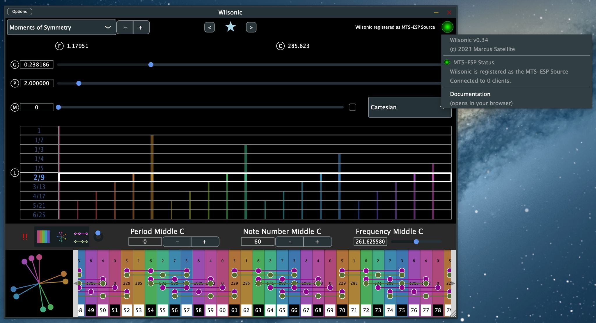
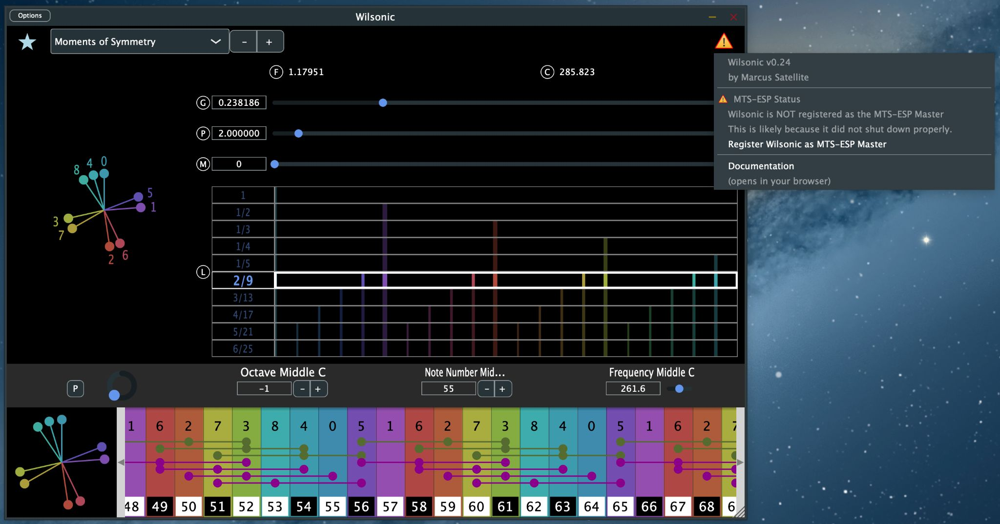

# Installation

Wilsonic MTS-ESP runs on macOS and Windows. The macOS release includes the
standalone apps plus AU and VST3 plugins, and the Windows release includes
the standalone apps plus VST3.

## Install

1. Download the current installer from
   [GitHub Releases](https://github.com/marcus-w-hobbs/Wilsonic-MTS-ESP/releases).
   The release notes there are the source of truth for versions and known
   issues, so please skim them before installing.
2. Run the installer.
3. Reboot your machine. The installer places the MTS-ESP library (libMTS)
   where every plugin on your system can find it, and a reboot makes sure
   nothing is holding a stale copy.

## Run it as a plugin

1. Rescan plugins in your DAW if it does not pick the new ones up
   automatically.
2. Load **Wilsonic** as an AU or VST3 on a MIDI track. The track's MIDI
   plays Wilsonic's simple synth, so you can check by ear that your other
   synths agree with it, and the scale-design parameters are automatable
   from this track.
3. Load your soft synths on other tracks as usual. Synths that support
   MTS-ESP follow Wilsonic's tuning automatically — that setup is the
   subject of [MTS-ESP and Your DAW](daw-setup.md).

## Run it standalone

The standalone Wilsonic app makes sound on its own through the built-in
simple synth, and it still broadcasts MTS-ESP: standalone synths such as
Surge XT and Pianoteq retune in real time while standalone Wilsonic runs.
The [Quick Start](quick-start.md) covers first sound; **Options →
Audio/MIDI Settings** covers device selection and MIDI input.

## The MTS-ESP status indicator

The top-right corner of the window shows the MTS-ESP status. You can hover
over the status label to see a history of status changes.

### Green

Green means this instance of Wilsonic is the active MTS-ESP master and is
managing the global tuning table. This is the normal state. Wilsonic should
be the **only** MTS-ESP master in your session, and I recommend not running
Wilsonic and WilsonicController at the same time, because I have not yet
built graceful hand-off between two apps that both want to be master.

### Yellow

Yellow means this instance is **not** managing the global tuning table. It
usually appears when another plugin is already acting as MTS-ESP master, or
after a crash left a stale master registered. Check that no other instance
of Wilsonic, WilsonicController, or any other MTS-ESP master plugin is
running, and then choose **Register** from the menu to make this instance
the master.

## Clean-installing the MTS-ESP library

The Wilsonic installer already includes everything MTS-ESP needs. If you
run into trouble you can reinstall the library directly from ODDSound:

- [macOS libMTS installer](https://github.com/ODDSound/MTS-ESP/raw/main/libMTS/Mac/libMTSMac_v1.02.pkg)
- [Windows libMTS installer](https://github.com/ODDSound/MTS-ESP/raw/main/libMTS/Win/libMTSWin_v1.02.exe)
