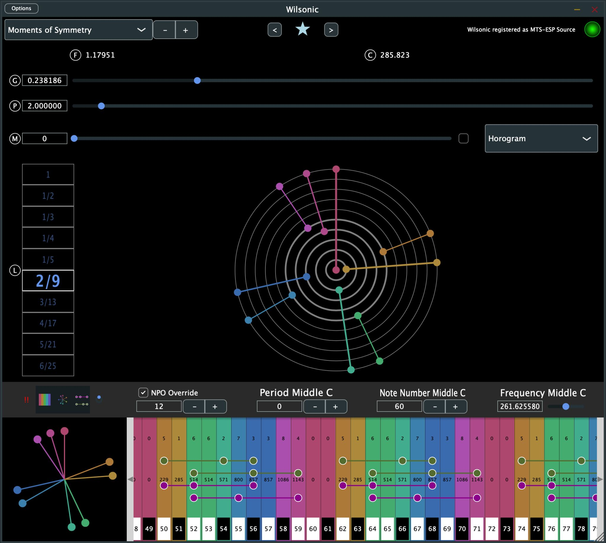
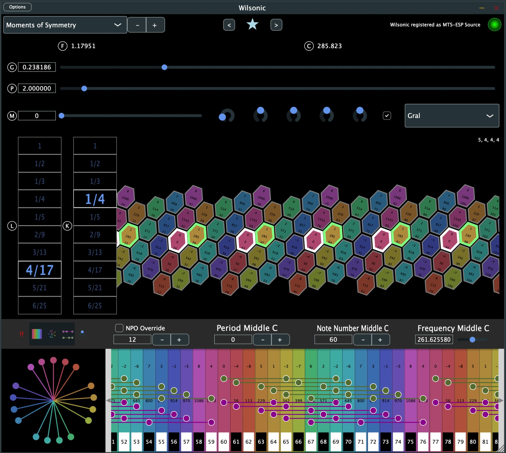
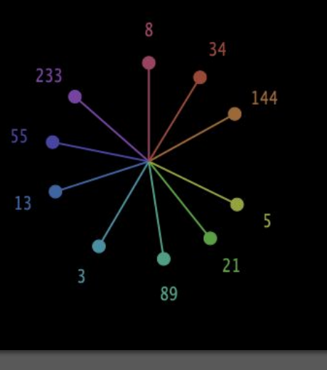
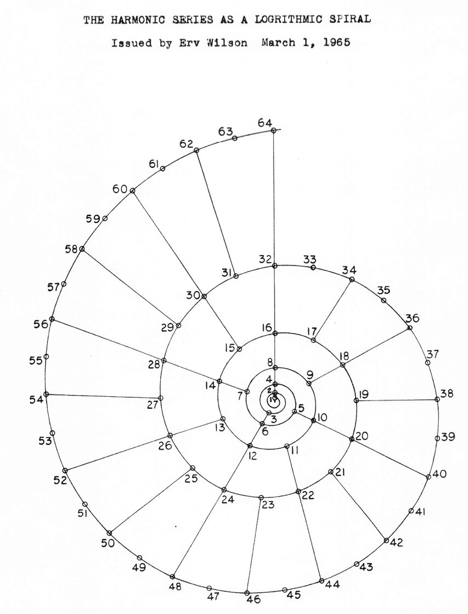
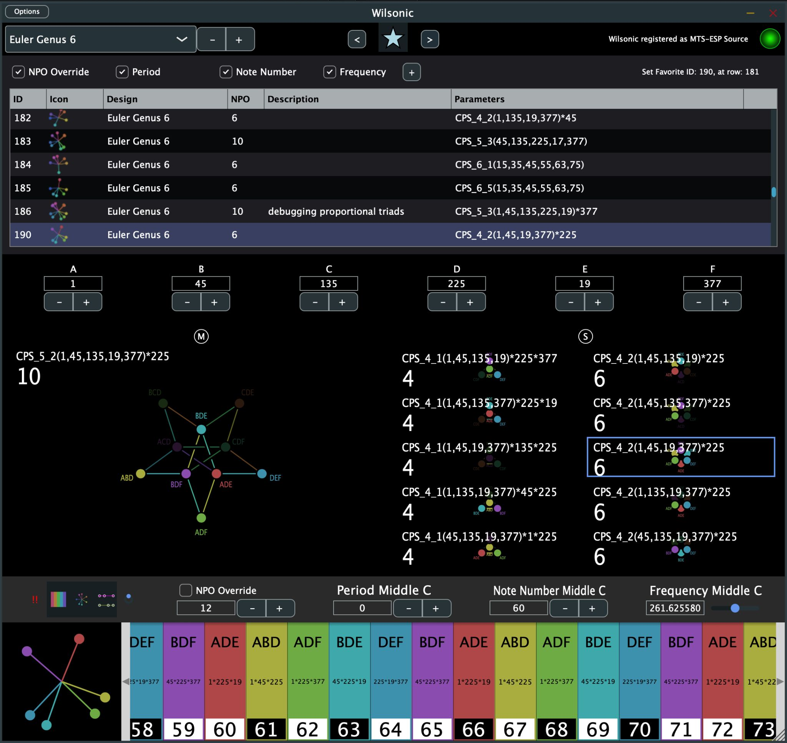

# The Interface

Every scale design shares the same frame: the Scale Design menu at the top,
the design's own editor in the middle, and the microtonal keyboard and
global tuning controls along the bottom. This chapter covers the shared
parts.

## The microtonal keyboard

The keyboard at the bottom of the window redraws in real time as you edit a
scale. Click or touch a key to play it through the simple synth. Resize the
keyboard by dragging its top bar vertically.

Three controls define the global tuning table's root frequency and MIDI
mapping, and all three are automatable in your DAW:

- **Frequency Middle C** — the frequency of middle C.
- **Note Number Middle C** — which MIDI note is the origin. The default is
  60 (middle C). Changing this transposes the mapping, so it doubles as a
  performance control.
- **Period Middle C** — lowers or raises all notes by whole periods
  (octaves, for a period of 2).

**NPO Override** ("notes per octave") adds or removes notes from the
mapping. If a key is greyed out it means no MIDI note is assigned to it;
use Note Number Middle C to shift the mapping until the notes you want are
in range.

### Real-time triad analysis

As you play, Wilsonic analyzes the sounding notes for
[Pythagorean means](https://en.wikipedia.org/wiki/Pythagorean_means) on the
frequencies:

- the [arithmetic mean](https://en.wikipedia.org/wiki/Arithmetic_mean)
  marks a **proportional triad**, the major-type sonority, and
- the [harmonic mean](https://en.wikipedia.org/wiki/Harmonic_mean) marks a
  **subcontrary triad**, the minor-type sonority.

These triads audibly lock in — their difference tones reinforce instead of
beating — and the keyboard highlights them as you play.

### Keyboard toggles

Alongside the keyboard you will find toggles to offset the pitch-wheel
color at middle C, highlight proportional triads, show the pitch wheel on
the keyboard itself, and show or hide the microtonal keyboard. A **MIDI
panic** button turns off all playing notes.

## The pitch wheel

Pitch wheels appear throughout the app, and they all draw the same way:
pitch is the log base-*period* of frequency, wrapped around a circle. The
period is 2 (the octave) in the most common case, and the wheel takes the
modulus of the period, which is octave equivalence: 1 = 2 = 4 = 8 = 16 and
so on. Twelve o'clock is C, which is "1", or 2 to the power 0. The colors
of the wheel correspond to the colors of the microtonal keyboard.

Because the wheel is log-base-period by definition, changing the period
does not change the drawing's appearance, and non-octave tunings — Scala
files, Moments of Symmetry with other periods — draw just as naturally.

The idea is old and good: Erv Wilson drew the harmonic series as a
logarithmic spiral in 1965, and the pitch wheel is that drawing's circular
cousin.

## Favorites

Favorites are saved scales you can return to, sort, and
[morph between](scale-designs.md#morph).

- Toggle the Favorites panel with the star icon. The panel takes a third
  of the window's height, so resize the window if you want more room.
- Save the current scale with the **+** button.
- Navigate with the **<** and **>** buttons.
- Toggles choose what gets saved with each Favorite: NPO Override, Period,
  Note Number Middle C, and Frequency Middle C.
- Double-click a Description cell to edit it.
- Select a row and hit backspace to delete it.
- Tap a column header to sort by ID, Design, NPO, or Description.
