# Scale Designs

Every scale in Wilsonic starts from the **Scale Design** menu at the top
left. Each design is an interactive implementation of a family of tuning
structures, most of them Erv Wilson's, and this chapter walks through all of
them in menu order of appearance. Whatever design you are in, the
[microtonal keyboard and pitch wheel](interface.md) update in real time, and
the design's parameters are automatable in your DAW.

## Wilson's Garden

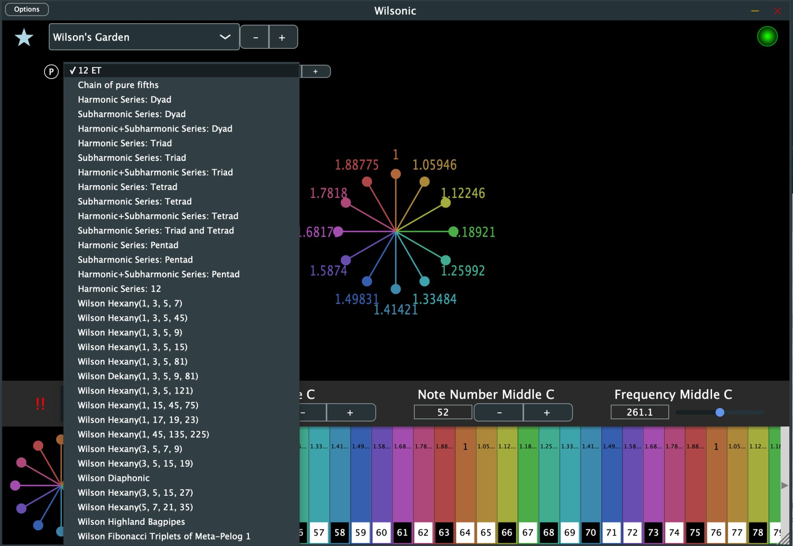

Wilson's Garden is the place to start: a set of curated presets drawn from
the work of Erv Wilson and the people around him.

1. Select **Wilson's Garden** from the Scale Design menu.
2. Select a scale from the **Curated Presets** menu.

The curated scales come from Erv Wilson, Kraig Grady, Stephen James Taylor,
Jose Garcia, Gary David, and me, plus a set of elementary, archetypal
scales. Once you have walked the garden, be sure to also explore the
[Scala archives](#scala), which bundle over five thousand scales.

## Moments of Symmetry

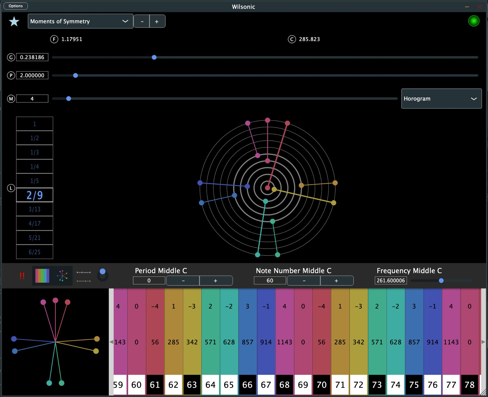

Moments of Symmetry (MOS) is Erv Wilson's best-known idea: stack one
interval (the generator) inside a repeating period, and certain counts of
tones form well-formed scales. His original papers are at
[Anaphoria](https://anaphoria.com/wilsonintroMOS.html).

1. Select **Moments of Symmetry** from the Scale Design menu.
2. Set the **Generator** with the slider. Units are pitch space, the
   log-base-period of frequency, so 0 is middle C and 1 is C one period
   higher. A generator of 0.58333 = 7/12 gives 12-tone equal temperament
   when the period is 2. The **F** label shows the generator as a
   frequency ratio and the **C** label shows it in cents.
3. Set the **Period** with its slider. Units are frequency; the default is
   2, the octave.
4. Set the **Murchana** with its slider — a murchana is a mode, or
   rotation, of the scale.
5. Select the **Level** by click-dragging over the level box. Each level is
   a moment of symmetry along the generator chain.

There are four drawing modes: **Cartesian**, **Horogram**, **Horogram
Inverse**, and **Gral**, the continuum of generalized keyboards.

### The Gral keyboard

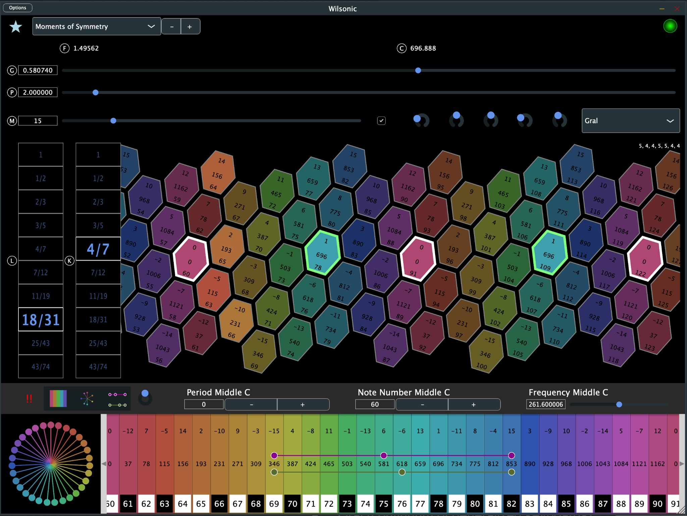

Select **Gral** from the display-mode popup and the MOS becomes a playable
generalized keyboard of hexagonal tiles, each labeled with scale degree,
frequency, and MIDI note number. It supports touch devices, so you can play
it directly.

- A secondary level box appears: this is the keyboard mapping, and its
  denominator is the number of columns in an octave. The 4/7 layout of the
  18/31 MOS is a good example.
- The toggle sets the murchana to 0 at the center of the chain, and it is
  automatable.
- The five knobs are zoom, rotation (leave at 0 and Wilsonic optimizes for
  horizontal layout), shear (use it to make the columns vertical), and the
  left-right and up-down positions of the keyboard.

## Persian-17 North Indian Raga Scales

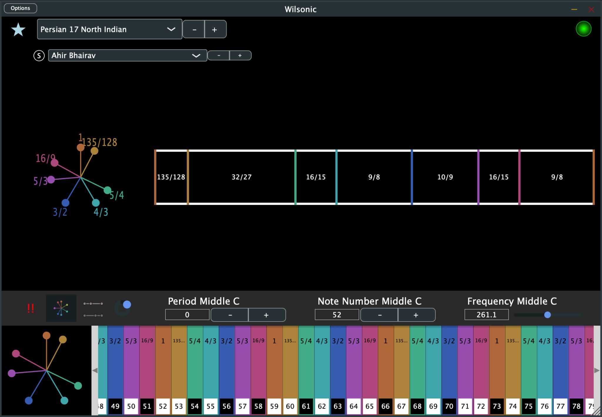

This design implements Erv Wilson's "17-Persian Version with North Indian
Raga Scales."

1. Select **Persian 17 North Indian** from the Scale Design menu.
2. Select the variant from the scale menu.

## Combination Product Sets

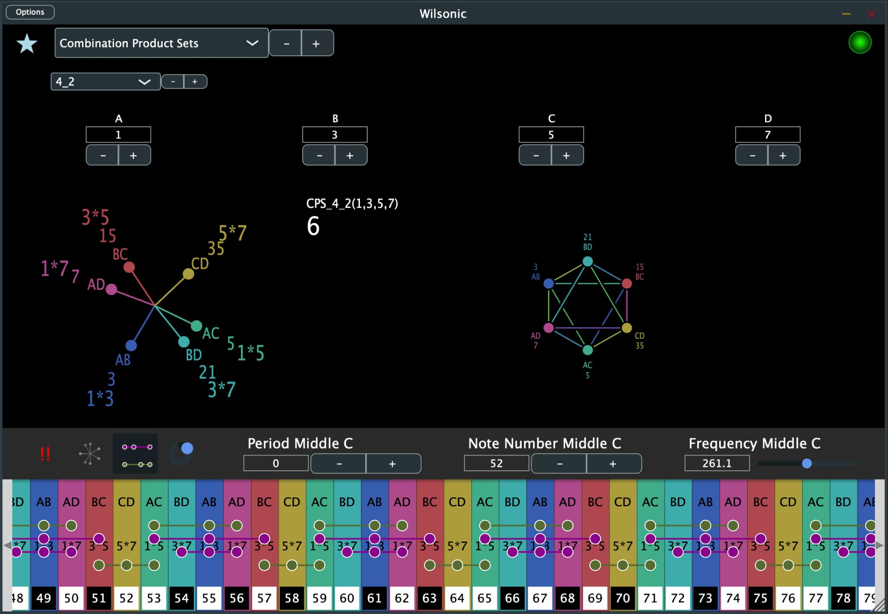

A Combination Product Set (CPS) takes a master set of harmonics and builds
a scale from the products of its combinations. These structures are among
Wilson's deepest work, and
[Anaphoria's CPS page](https://anaphoria.com/wilsoncps.html) collects the
source papers.

1. Select **Combination Product Sets** from the Scale Design menu.
2. Select the CPS from the scale menu. The names read as "n choose k":
   - **4_1** = 4 choose 1 = Harmonic Tetrany
   - **4_2** = 4 choose 2 = Hexany
   - **4_3** = 4 choose 3 = Subharmonic Tetrany
   - **6_3** = 6 choose 3 = Eikosany
3. Set the seeds (A, B, C, D, …) of the master set.

## Euler Genus 6

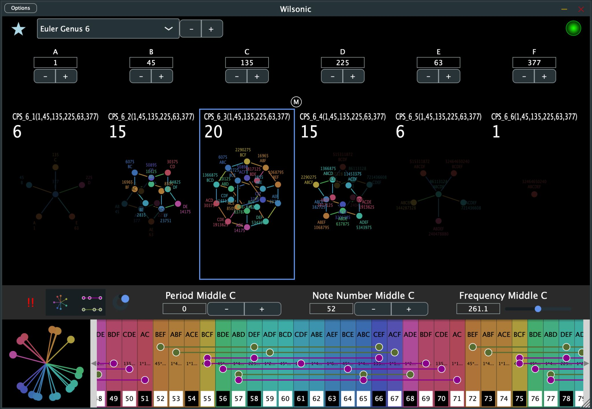

Euler Genus 6 generates the full genus of six seeds and lets you drill into
every subset. Wilson's paper is at
[Anaphoria](https://anaphoria.com/genus.pdf).

On the main page:

- Seeds can be changed on every page.
- The selected scale is outlined in blue.
- Shift-mouse-hover selects a scale, and cursor left/right steps the
  selection.
- Ctrl-click drills into the subset page.

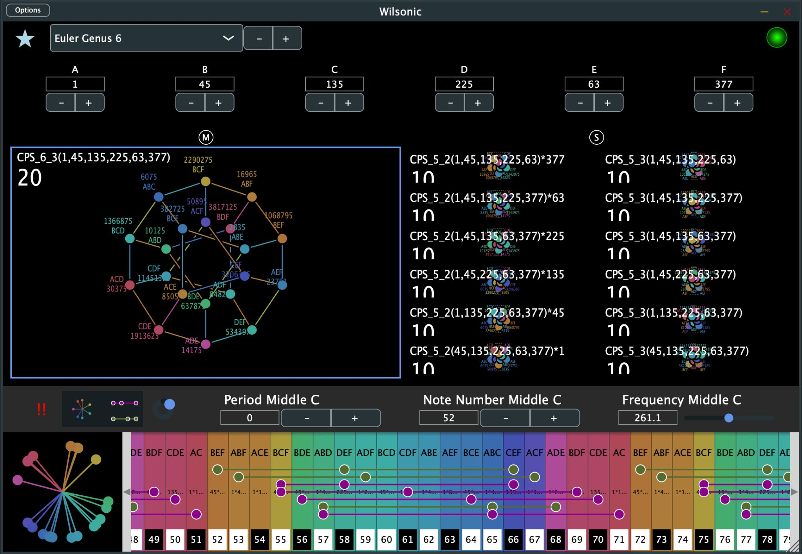

On the subset page the superset is on the left and its subsets are on the
right. Ctrl-click navigates down into a subset, command-click navigates up
into the superset, and the cursor keys move the selection in all four
directions.

The Combination Product Sets and Euler Genus 6 designs implement these
canonical papers:

- [D'Alessandro, Like a Hurricane](http://www.anaphoria.com/dal.pdf), Erv Wilson
- [Combination-Product Set Patterns](http://www.anaphoria.com/cps.pdf), Kraig Grady, 1986
- [The Eikosany Viewed from the Centered Pentad Lattice](http://www.anaphoria.com/eikocenterpentad.pdf), Kraig Grady
- [The Eikosany Viewed from a Hexany Lattice](http://www.anaphoria.com/eikohex.pdf), Kraig Grady
- Cycle of Hexanies in a Dekany, Kraig Grady, 1998
- [Resources of the Eikosany](http://www.anaphoria.com/eikosanyresources.jpg), Kraig Grady, 1985

## Recurrence Relations

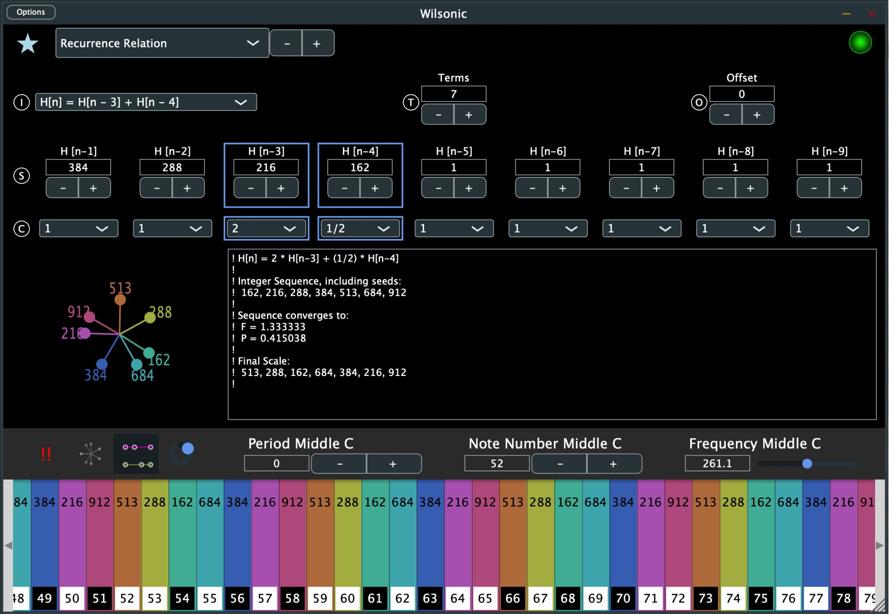

Recurrence relations build additive sequences — the Fibonacci numbers are
the most famous — and Wilson explored them as scale generators under the
name Meru. His papers are at
[Anaphoria](https://anaphoria.com/wilsonintroMERU.html). Because each term
is a sum of earlier terms, these scales optimize for difference tones.

1. Select **Recurrence Relation** from the Scale Design menu.
2. Select the terms of the recurrence relation from the dropdown; selected
   terms are highlighted in blue.
3. Select the number of terms to compute, and the offset, which throws
   away the earliest terms.
4. Set your seeds (the initial conditions) and your coefficients for each
   term.

The final scale is sorted as if octave-reduced, and the period is 2.

## Equal Temperament

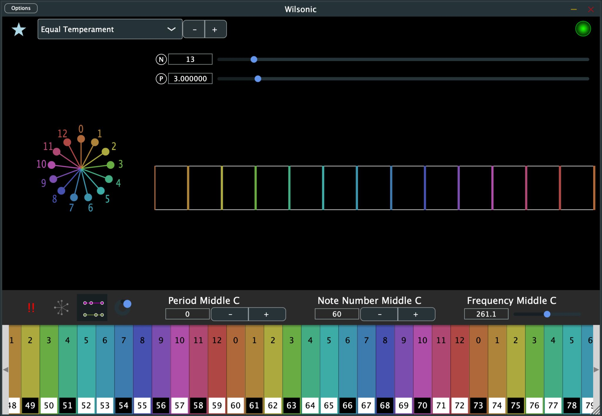

1. Select **Equal Temperament** from the Scale Design menu.
2. Select an ET ("EDO") from 1 to 128 notes per octave.
3. Select the period. "Octave" is a period of 2, and other periods give
   you equal divisions of any interval.

## Tritriadic

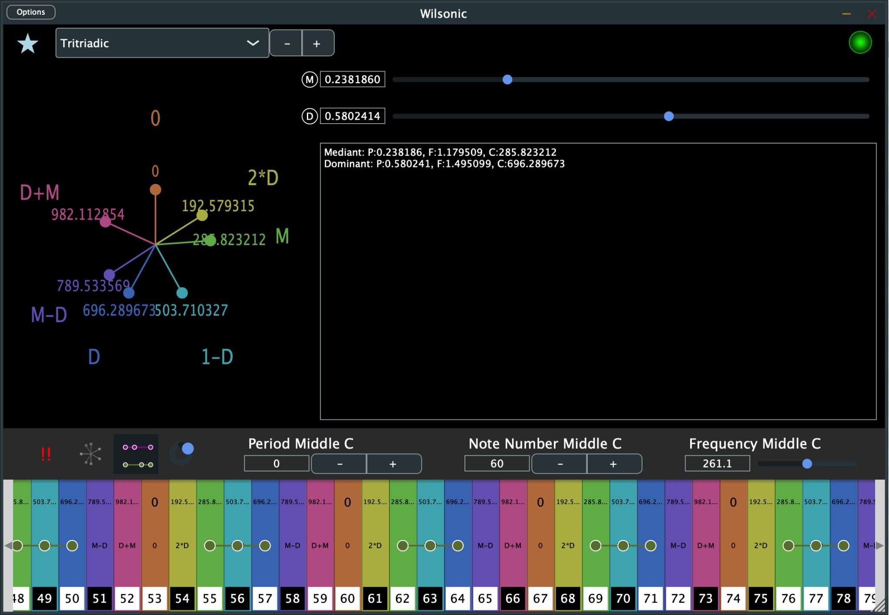

Tritriadic scales are John Chalmers's design: three triads — subdominant,
tonic, dominant — built from a tonic, mediant, and dominant interval, with
the major scale as the template.

1. Select **Tritriadic** from the Scale Design menu.
2. Select the **Mediant** with its slider.
3. Select the **Dominant** with its slider.

John wrote this description for Wilsonic:

> Tritriadics are very simple and are based on the major scale as a
> template. They are defined as three triads composed of a tonic, mediant
> and dominant interval. Let us set the tonic to 0 [in cents], then the
> basic triad has the form 0, M, D. By adding a subdominant triad 1200−D,
> M−D, 1200 and a dominant triad D, D+M, 2D, one gets an octave-spanning
> scale. In JI, take any triad such as 4:5:6 and write it as 1/1 5/4 3/2.
> The subdominant is the octave-adjusted triad obtained by dividing by D,
> or more conveniently 4/3 5/3 2/1, and the dominant triad is the tonic
> multiplied by the dominant interval, which yields 3/2, 15/8 and 9/8 —
> together, in ascending order, 1/1 9/8 5/4 4/3 5/3 15/8 2/1. Any triad
> may be used — 4:5:6, 4:5:7, or even irrational numbers.
>
> — John Chalmers, May 4, 2022

See [Xenharmonikon](https://www.xenharmonikon.org/2024/06/17/tritriadic-scales-with-seven-tones/)
for more details.

## Scala

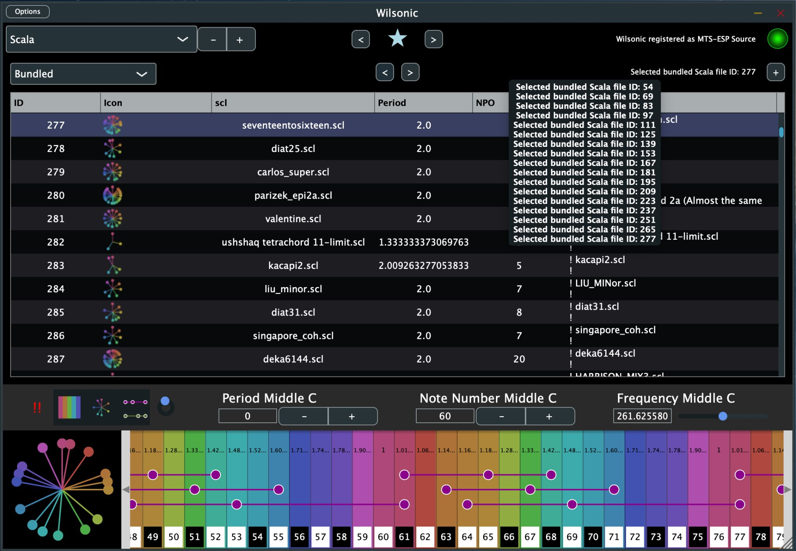

Wilsonic bundles the
[Huygens-Fokker Scala archive](https://www.huygens-fokker.org/microtonality/scales.html) —
more than 5,100 .scl files, read-only, with a shoutout to Manuel op de
Coul — and supports your own files alongside it. Non-octave tunings are
fully supported.

1. Select **Scala** from the Scale Design menu.
2. Select **Bundled** or **User**.
3. Highlight a row and hit return to tune up the microtonal keyboard.
4. Mouse-hover over a row to see the contents of the Scala file.

When **User** is selected you can import and delete your own .scl files:
drag and drop files into the window, or click **+** for a file browser,
and select-backspace to delete. User/Bundled and the file IDs are
automatable, and you can save Scala files as Favorites.

## CoPrime Grid

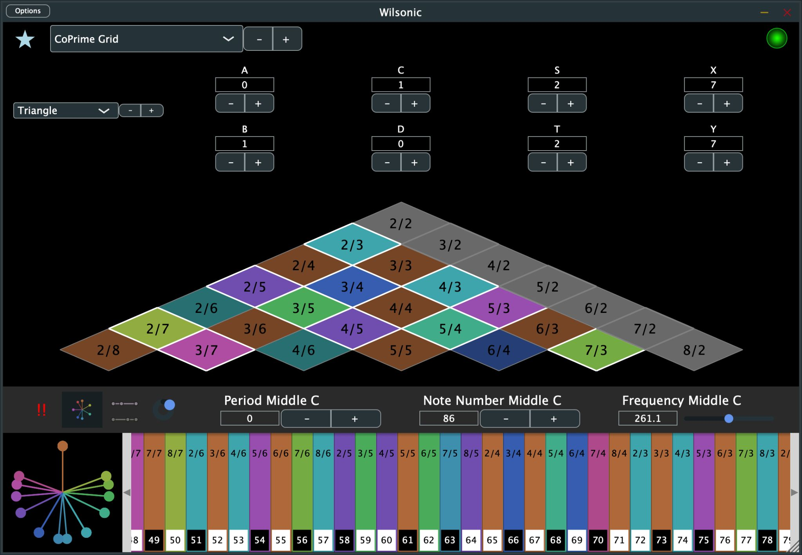

The CoPrime Grid is one of Erv Wilson's most remarkable late designs; see
[his papers](https://anaphoria.com/pecan.pdf), the
[20-seed grid](https://anaphoria.com/coprime20seed.pdf), and
[Kraig Grady's Anaphoria pages](https://anaphoria.com/wilsondiamondcoprime.html)
for its construction and properties.

1. Select **CoPrime Grid** from the Scale Design menu.
2. Select **Harmonic**, **Triangle**, or **Subharmonic** — the same tones
   in different layouts.
3. Reseed the grid by modifying A, B, C, D; offset with S and T; and
   expand or reduce the number of terms with X and Y.

On touchscreens you can play the geometry itself as a keyboard, and it is
best played on a two-dimensional controller such as the Linnstrument. If a
note is greyed out there is no MIDI note assigned to it; use **Note Number
Middle C** to shift the root until the notes you want are in range.

## Diamonds

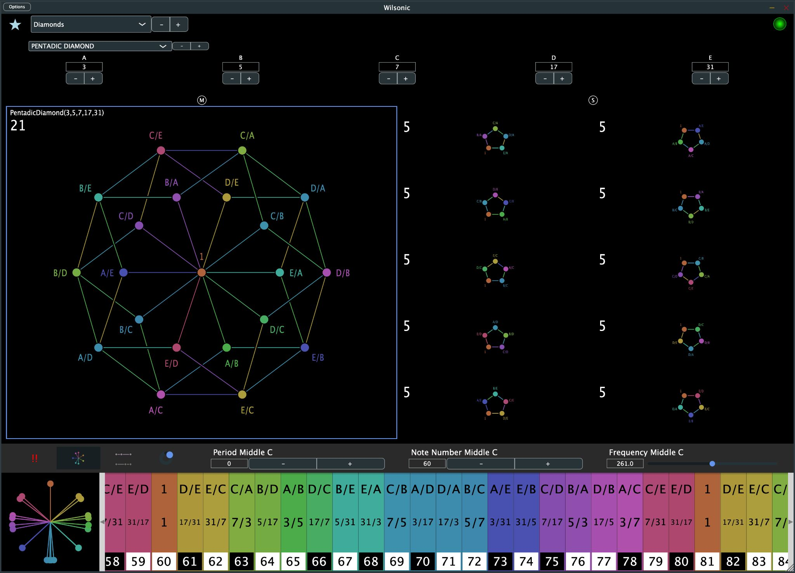

Diamonds are reciprocal cross-sets: scales built by crossing a master set
against its own reciprocals. Wilson's diamond papers are at
[Anaphoria](https://anaphoria.com/diamond.pdf).

1. Select **Diamonds** from the Scale Design menu.
2. Select a Diamond or one of its harmonic/subharmonic subsets, from
   Triadic seeds (A, B, C) up to Ogdoadic seeds (A through H).
3. Set the seeds of the master set.

The selected scale is outlined in blue; shift-mouse-hover selects, and
cursor left/right steps the selection. There is also a
[video demo of Diamonds](https://youtu.be/kw6MbCKKqxQ).

A reciprocal cross-set is simple to state: rows are the harmonic series of
the master set, and columns are the subharmonic series, so row 0 is the
harmonic series divided by A, column 0 is the subharmonic series multiplied
by A, and the diagonal is 1/1. For the Triadic case:

| | | |
|---|---|---|
| 1/1 | B/A | C/A |
| A/B | 1/1 | C/B |
| A/C | B/C | 1/1 |

The same construction extends to Tetradic, Pentadic, and on up to the
Ogdoadic diamond's eight seeds.

## Morph

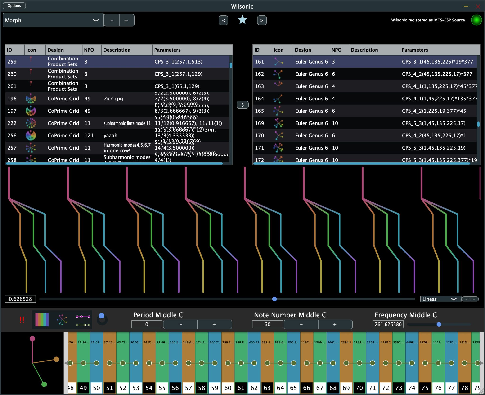

Morph interpolates between two saved [Favorites](interface.md#favorites),
which makes scale changes performable and automatable.

1. Select **Morph** from the Scale Design menu.
2. The left panel of Favorites is **A**, the right panel is **B**, and
   **S** swaps them.
3. The top box shows A, the bottom box shows B, and the middle box is the
   morph of the two.
4. The interpolation slider moves between A and B, with a choice of
   **Linear** or **Pitch** interpolation.

ID A, ID B, the interpolation amount, and the interpolation type are all
automatable in your DAW. The pitch wheel and microtonal keyboard reflect
the state of the morph, including proportional-triad highlighting. You can
even save a Morph as a Favorite — though you cannot morph between two
Morphs.

## Partch

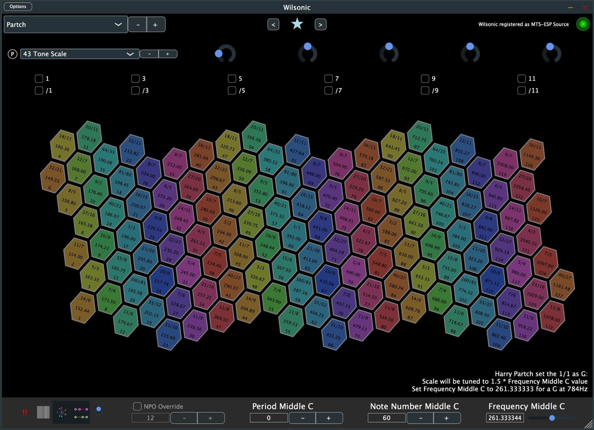

This design presents Harry Partch's 43-tone scale and his instrument
mappings.

1. Select **Partch** from the Scale Design menu.
2. Select **43 Tone Scale**.

Knobs control scale, rotation, shear, and X/Y translation of the layout,
and toggles highlight the Otonalities and Utonalities. Each hexagon carries
three labels: ratio, frequency, and MIDI note number. You can play the
scale with the mouse or by touch.

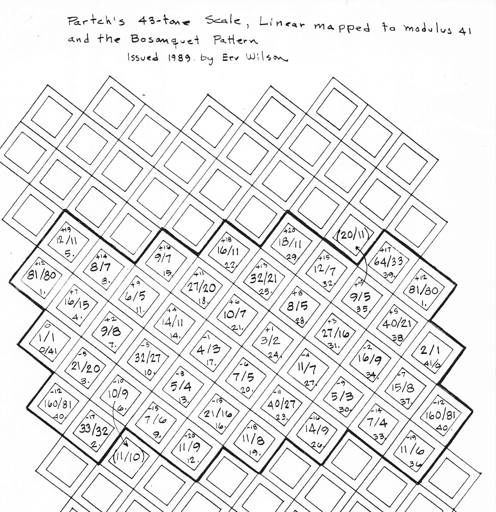

The hexagonal layout is Erv Wilson's own figure for the Partch 43-tone
scale, mapped to a Gral keyboard by Stephen James Taylor.

### Diamond Marimba: 43 Mapping

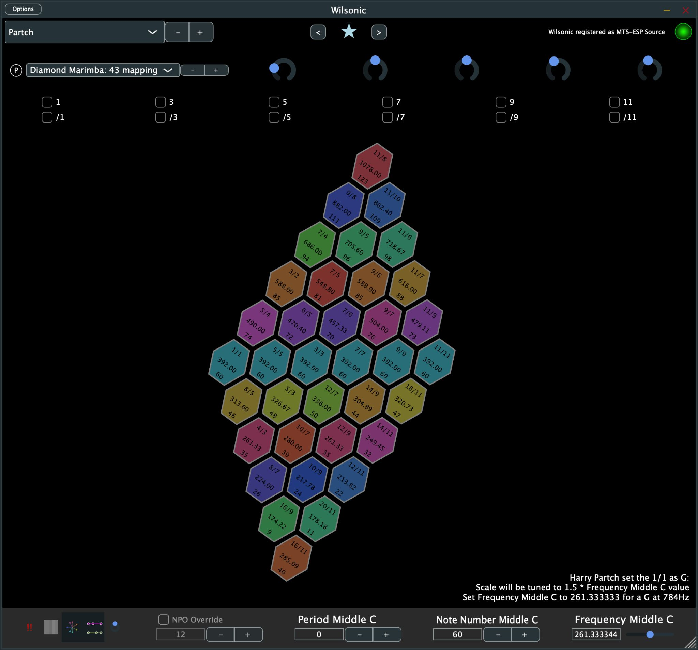

This version of the Diamond Marimba plays a subset of the Partch 43 scale
using the **same MIDI mapping** as the 43-tone scale, so you can mix and
match MIDI recordings between the two.

### Diamond Marimba

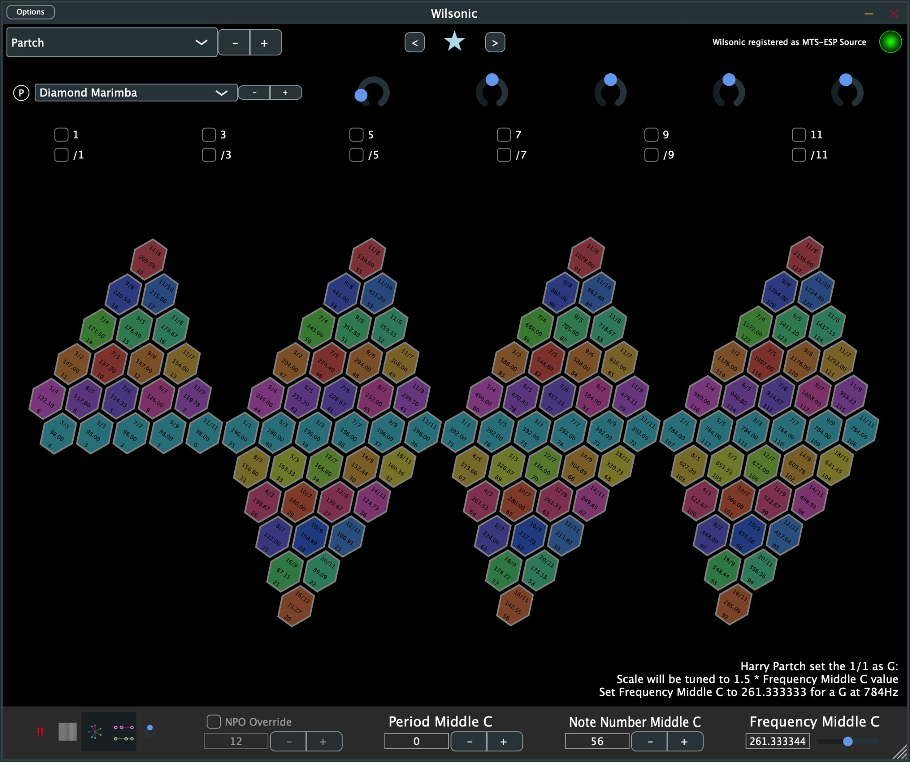

This version fits more than three Diamond Marimbas across the 128 MIDI note
numbers.

### Quadrangularis Reversum

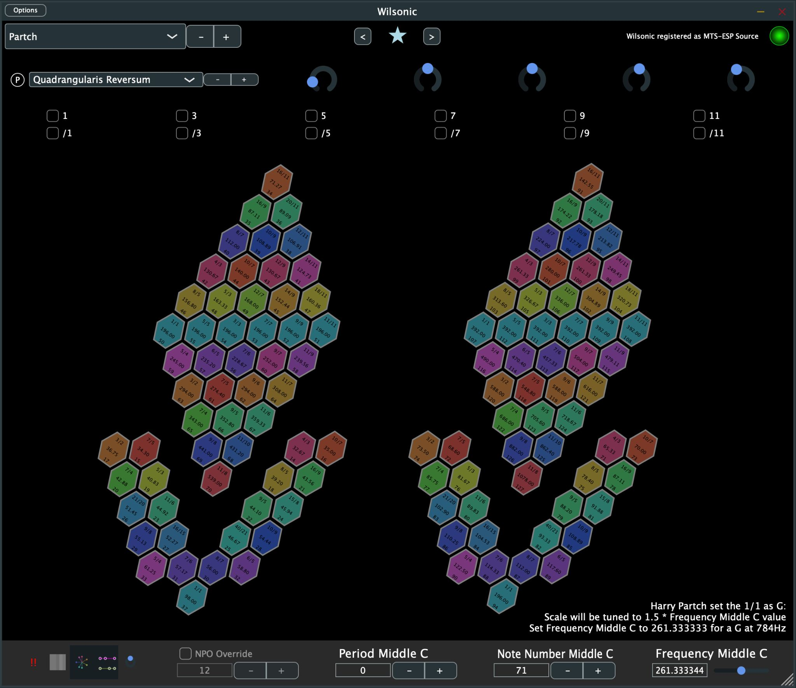

Partch's Quadrangularis Reversum, with two-plus instruments mapped across
the 128 MIDI note numbers.
